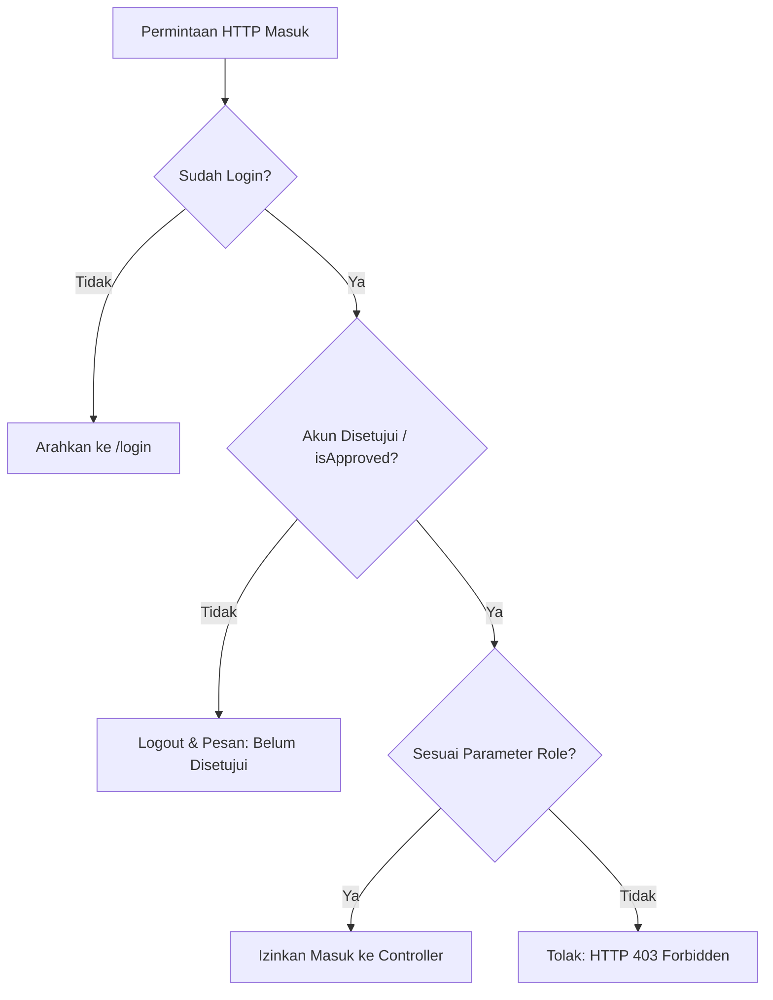
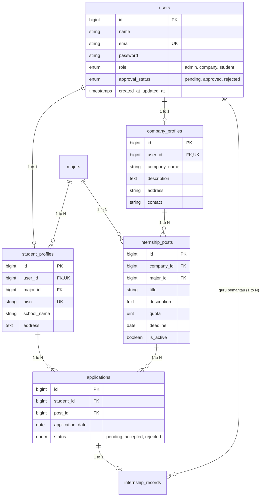
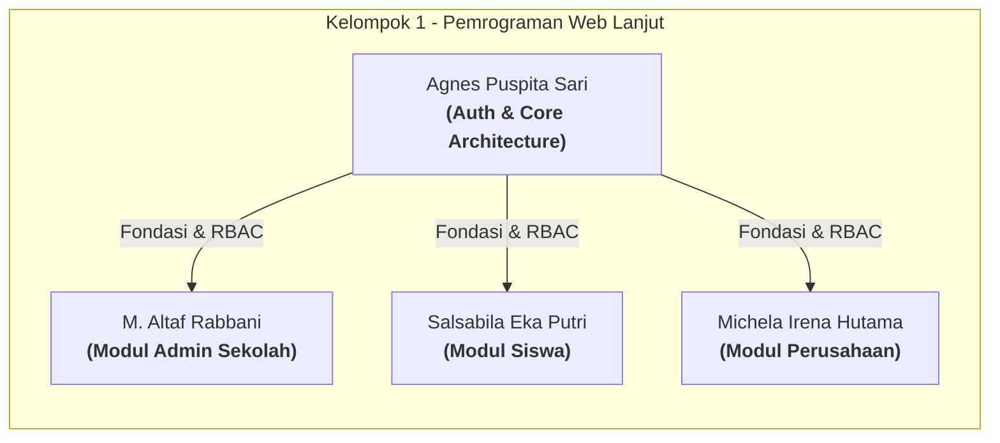

# DOKUMENTASI SELURUH PROJECT
## PKLoka — Sistem Informasi Praktik Kerja Lapangan (PKL) Berbasis Web Menggunakan Laravel

Berkas ini menjelaskan **seluruh project dari awal sampai kondisi akhir** dalam satu tempat:
apa yang dibangun, untuk siapa, bagaimana cara kerjanya, struktur database dan migrasi,
peta route, aturan bisnis yang diterapkan, pengujian yang telah dilakukan, keputusan desain
yang diambil beserta alasannya, dan pembagian tugas pengerjaan per anggota tim.

Disusun: November 2026 · Kelompok 1 Pemrograman Web Lanjut (S1 Sistem Informasi, FMIPA Universitas Lampung)  
Sumber informasi: Proposal Perancangan PKLoka (PDF), berkas migrasi database, model Eloquent, controller, route, dan *test suite* project.

Berkas ini bersifat **penjelasan dan rangkuman komprehensif**. Sumber kebenaran teknis implementasi berada pada kode sumber Laravel di repositori ini.

---

### Daftar Isi
1. [Ringkasan Project](#1-ringkasan-project)
2. [Identitas Sistem & Tim Pengembang](#2-identitas-sistem--tim-pengembang)
3. [Teknologi & Versi](#3-teknologi--versi)
4. [Cara Menjalankan](#4-cara-menjalankan)
5. [Struktur Direktori](#5-struktur-direktori)
6. [Peran & Hak Akses (RBAC)](#6-peran--hak-akses-rbac)
7. [Basis Data & Migrasi](#7-basis-data--migrasi)
8. [Peta Route (41 Route)](#8-peta-route-41-route)
9. [Fitur & Penjelasan Sistem](#9-fitur--penjelasan-sistem)
10. [Kontrak Status & Siklus Hidup](#10-kontrak-status--siklus-hidup)
11. [Aturan Bisnis yang Diterapkan](#11-aturan-bisnis-yang-diterapkan)
12. [Keamanan & Perlindungan Data](#12-keamanan--perlindungan-data)
13. [Pengujian Otomatis & Skenario Uji](#13-pengujian-otomatis--skenario-uji)
14. [Keputusan Desain & Penyempurnaan dari Dokumen Awal](#14-keputusan-desain--penyempurnaan-dari-dokumen-awal)
15. [Pembagian Kerja 4 Anggota Tim](#15-pembagian-kerja-4-anggota-tim)
16. [Riwayat Perubahan & Tahap Pengembangan](#16-riwayat-perubahan--tahap-pengembangan)
17. [Pemenuhan Ketentuan Final Project & Definition of Done](#17-pemenuhan-ketentuan-final-project--definition-of-done)

---

## 1. Ringkasan Project

**Apa:** **PKLoka** adalah platform sistem informasi berbasis web yang dirancang khusus untuk memfasilitasi pelaksanaan Praktik Kerja Lapangan (PKL) bagi siswa SMA/SMK dengan mempertemukan tiga pemangku kepentingan (*stakeholders*) utama: **Siswa**, **Perusahaan (Mitra Industri)**, dan **Pihak Sekolah (Admin / Guru Pembimbing)**.

**Masalah yang Diselesaikan:**
Sebelum adanya sistem ini, siswa mencari tempat PKL secara mandiri dan sporadis lewat relasi pribadi atau media sosial tanpa kepastian relevansi dengan kompetensi keahlian/jurusan mereka. Mitra industri kesulitan mengumumkan kebutuhan siswa magang secara tertarget, dan pihak sekolah mengalami kendala dalam memvalidasi kelayakan perusahaan serta memantau status penempatan siswa.

PKLoka menyelesaikan siklus ini secara *end-to-end*:
1. Perusahaan mendaftar dan diverifikasi oleh pihak sekolah.
2. Perusahaan mempublikasikan lowongan PKL dengan syarat jurusan, kuota, dan tenggat waktu.
3. Siswa mencari lowongan yang sesuai dengan jurusannya dan mengajukan lamaran secara daring.
4. Perusahaan menyeleksi pelamar (menerima atau menolak).
5. Ketika siswa diterima di suatu lowongan, sistem secara otomatis mengunci lamaran lain agar tidak terjadi penerimaan ganda, dan sekolah dapat memantau penempatan tersebut secara *real-time*.

### Tiga Peran Pengguna Utama

| Peran | Nilai Teknis (`role`) | Tanggung Jawab Utama di Aplikasi |
|---|---|---|
| **Admin Sekolah / Guru** | `admin` | Memverifikasi pendaftaran perusahaan (*approval*), mengelola akun dan data profil siswa, memantau seluruh lowongan yang diterbitkan, serta mengawasi rekapitulasi status pendaftaran dan pelaksanaan PKL siswa. |
| **Perusahaan (Mitra Industri)** | `company` | Melakukan registrasi akun, melengkapi profil institusi, mengelola (*CRUD*) lowongan PKL, meninjau data siswa pelamar, dan menentukan hasil seleksi (menerima/menolak pelamar). |
| **Siswa (Student)** | `student` | Melengkapi profil biodata (NISN, jurusan, asal sekolah), mengeksplorasi lowongan sesuai jurusan, mengajukan pendaftaran PKL, dan memantau status lamaran. |

### Ukuran Project (Kondisi Saat Ini)

| Metrik | Nilai | Keterangan |
|---|---|---|
| **Route Aplikasi** | **38 route** (total 41 termasuk route bawaan Laravel: `up`, `storage.local`, `storage.local.upload`) | Seluruh alur terproteksi middleware |
| **Tabel Database** | **14 tabel** | 6 tabel utama domain bisnis + 8 tabel sistem bawaan framework |
| **Berkas Migrasi** | **9 berkas migrasi** | Terstruktur rapi dengan *foreign key constraint* |
| **Model Eloquent** | **6 model** | `User`, `StudentProfile`, `CompanyProfile`, `InternshipPost`, `Application`, `Major` |
| **Berkas Controller** | **17 berkas controller** | Terbagi modular ke subfolder `Admin/`, `Company/`, `Student/`, `Auth/` |
| **Berkas Tampilan (Blade)** | **22 berkas blade** | Template terintegrasi Tailwind CSS, responsif untuk desktop dan mobile |
| **Pengujian Otomatis** | **7 skenario teruji pada `PklokaSystemTest.php`** | Menguji RBAC, alur pendaftaran, approval, CRUD, dan integritas bisnis |
| **Database Supported** | **PostgreSQL** (lingkungan aplikasi) & **SQLite** (lingkungan test) | Sesuai standar framework Laravel |

---

## 2. Identitas Sistem & Tim Pengembang

| Aspek | Informasi |
|---|---|
| **Nama Sistem** | **PKLoka** (Portal Sistem Informasi Praktik Kerja Lapangan) |
| **Mata Kuliah** | Pemrograman Web Lanjut |
| **Dosen Pengampu** | 1. M. Iqbal Parabi, S.Si., M.T.<br>2. Muhammad Ikhsan, S.Kom., M.Cs. |
| **Institusi** | Jurusan Ilmu Komputer, Program Studi S1 Sistem Informasi, Fakultas Matematika dan Ilmu Pengetahuan Alam, Universitas Lampung |
| **Tahun Penyusunan** | 2026 |
| **Bahasa Antarmuka** | Bahasa Indonesia |
| **Zona Waktu** | Asia/Jakarta (`WIB`) |
| **Nuansa Desain** | Tema modern profesional berbasis Tailwind CSS dengan warna utama Tosca (`teal-700` / `#0F766E`) dan aksen Tosca terang (`teal-400` / `#2DD4BF`), serta Emerald (`#10B981`) untuk status sukses |

### Anggota Tim Pengembang (Kelompok 1)

| No | Nama Mahasiswa | NPM | Peran Utama |
|:--:|---|:--:|---|
| 1 | **Agnes Puspita Sari** | 2417052022 | Ketua Tim & Arsitektur Sistem, Modul Autentikasi, Middleware RBAC |
| 2 | **M. Altaf Rabbani** | 2457052010 | Modul Admin Sekolah (Persetujuan Perusahaan, CRUD Siswa & Monitoring) |
| 3 | **Salsabila Eka Putri** | 2417052015 | Modul Siswa (Eksplorasi Lowongan, Pendaftaran PKL & Profil Siswa) |
| 4 | **Michela Irena Hutama** | 2417052009 | Modul Perusahaan (Profil Perusahaan, CRUD Lowongan & Seleksi Pelamar) |

---

## 3. Teknologi & Versi

Sistem ini dibangun dengan mematuhi secara penuh seluruh ketentuan teknis final project:

| Komponen | Spesifikasi / Versi | Pemenuhan Ketentuan |
|---|---|---|
| **Framework** | **Laravel 12.69.3** | Memenuhi syarat **min. versi 11.x** |
| **Bahasa Pemrograman** | **PHP 8.3.26** | Memenuhi syarat **min. PHP 8.2** |
| **Database** | **PostgreSQL** (port 5432) & **SQLite** (`:memory:` untuk unit/feature testing) | Memenuhi syarat **PostgreSQL / MySQL** |
| **Frontend Styling** | **Tailwind CSS v4** + Vite 6 | Antarmuka bersih, responsif (*mobile-friendly*) |
| **Arsitektur** | MVC (*Model-View-Controller*) modular dengan *Role-Based Access Control* (RBAC) | Terisolasi per peran |
| **Dependency Manager**| Composer 2.x & npm 10.x | Standar modern Laravel |

---

## 4. Cara Menjalankan

### 4.1 Prasyarat Sistem
- PHP versi 8.2 atau lebih baru (pada lingkungan ini menggunakan PHP 8.3).
- PostgreSQL versi 15+ / 16+ (atau via pgAdmin).
- Composer versi 2.x.
- Node.js versi 18+ dan npm.

### 4.2 Langkah Instalasi

```bash
# 1. Masuk ke direktori project
cd C:\laragon\www\pwl_team1

# 2. Pasang dependensi PHP dan JavaScript
composer install
npm install

# 3. Konfigurasi file lingkungan (.env)
cp .env.example .env     # Windows PowerShell: copy .env.example .env
php artisan key:generate
```

Sesuaikan konfigurasi database pada berkas `.env`:
```env
DB_CONNECTION=pgsql
DB_HOST=127.0.0.1
DB_PORT=5432
DB_DATABASE=pkloka_db
DB_USERNAME=postgres
DB_PASSWORD=<password_kamu>
```

Jalankan migrasi dan seeder untuk mengisi data awal:
```bash
# 4. Eksekusi migrasi database dan pengisian data demo
php artisan migrate --seed

# 5. Build aset tampilan
npm run build            # atau 'npm run dev' untuk live reloading

# 6. Jalankan server lokal Laravel
php artisan serve
```

Aplikasi dapat diakses melalui peramban web di: **`http://127.0.0.1:8000`** atau host lokal Laragon **`http://pwl_team1.test`**.

### 4.3 Kredensial Akun Pengujian (*Demo Data*)

Database seeder telah menyediakan akun siap pakai untuk menguji ketiga peran:

| Peran | Alamat Email | Kata Sandi | Status Akses |
|---|---|---|---|
| **Admin Sekolah** | `admin@pkloka.test` | `password` | Aktif (Akses seluruh dashboard admin) |
| **Perusahaan (Mitra)** | `tech@solusi.test` | `password` | *Approved* (PT Solusi Teknologi Nusantara) |
| **Siswa 1 (PPLG)** | `ahmad@student.test` | `password` | Aktif (Jurusan Rekayasa Perangkat Lunak) |
| **Siswa 2 (DKV)** | `siti@student.test` | `password` | Aktif (Jurusan Desain Komunikasi Visual) |

---

## 5. Struktur Direktori

Project diorganisasi mengikuti konvensi Laravel modern dengan pengelompokan controller dan view yang jelas berdasarkan peran pengguna:

```text
pwl_team1/
├── app/
│   ├── Http/
│   │   ├── Controllers/
│   │   │   ├── Controller.php
│   │   │   ├── DashboardController.php              # Dispatcher dashboard sesuai role login
│   │   │   ├── Admin/                               # Area Pihak Sekolah
│   │   │   │   ├── ApplicationController.php        # Audit seluruh lamaran siswa
│   │   │   │   ├── CompanyApprovalController.php    # Persetujuan/penolakan registrasi perusahaan
│   │   │   │   ├── DashboardController.php          # Statistik & ringkasan sekolah
│   │   │   │   ├── InternshipPostController.php     # Audit seluruh lowongan PKL
│   │   │   │   └── StudentController.php            # CRUD data siswa (akun + profil)
│   │   │   ├── Auth/                                # Area Otentikasi
│   │   │   │   ├── LoginController.php              # Login & Logout
│   │   │   │   └── RegisterCompanyController.php    # Registrasi mitra industri baru
│   │   │   ├── Company/                             # Area Perusahaan
│   │   │   │   ├── ApplicantController.php          # Review pelamar & aksi accept/reject
│   │   │   │   ├── DashboardController.php          # Ringkasan lowongan & pelamar
│   │   │   │   ├── InternshipPostController.php     # CRUD lowongan PKL perusahaan
│   │   │   │   └── ProfileController.php            # Edit profil instansi
│   │   │   └── Student/                             # Area Siswa
│   │   │       ├── ApplicationController.php        # Riwayat & aksi pengajuan lamaran
│   │   │       ├── DashboardController.php          # Rekap status lamaran siswa
│   │   │       ├── InternshipPostController.php     # Eksplorasi katalog lowongan
│   │   │       └── ProfileController.php            # Pengelolaan data pribadi & kontak
│   │   └── Middleware/
│   │       └── EnsureRole.php                       # RBAC Middleware ('role:admin', 'role:company', dll.)
│   └── Models/
│       ├── Application.php                          # Model lamaran PKL (status pending/accepted/rejected)
│       ├── CompanyProfile.php                       # Model profil perusahaan
│       ├── InternshipPost.php                       # Model lowongan magang PKL
│       ├── Major.php                                # Model referensi jurusan/kompetensi keahlian
│       ├── StudentProfile.php                       # Model profil siswa (NISN, jurusan, sekolah)
│       └── User.php                                 # Model akun pengguna (role & approval_status)
├── database/
│   ├── migrations/                                  # 9 berkas migrasi tabel database
│   └── seeders/
│       ├── AdminSeeder.php                          # Seeder akun admin awal
│       ├── DatabaseSeeder.php                       # Master runner seeder
│       ├── DemoDataSeeder.php                       # Seeder lengkap dummy data siap uji
│       └── MajorSeeder.php                          # Seeder data jurusan SMK standar
├── resources/
│   ├── css/                                         # app.css (Tailwind CSS source)
│   └── views/                                       # 22 berkas Blade
│       ├── admin/                                   # View dashboard, siswa, verifikasi perusahaan, lowongan
│       ├── auth/                                    # View login & registrasi perusahaan
│       ├── company/                                 # View dashboard, CRUD lowongan, seleksi pelamar, profil
│       ├── layouts/                                 # Layout utama app.blade.php
│       ├── student/                                 # View dashboard siswa, katalog lowongan, detail, profil
│       └── welcome.blade.php                        # Halaman landing page publik
├── routes/
│   ├── web.php                                      # 38 route aplikasi + pengelompokan RBAC
│   └── console.php
└── tests/
    └── Feature/
        ├── ExampleTest.php
        └── PklokaSystemTest.php                     # Skenario pengujian lengkap sistem PKLoka
```

---

## 6. Peran & Hak Akses (RBAC)

Pemisahan akses diimplementasikan secara kokoh menggunakan middleware `EnsureRole` yang didaftarkan pada alias `'role'` di berkas `bootstrap/app.php`. Pengguna yang mencoba mengakses rute di luar wewenangnya akan langsung dihadang dengan pesan kesalahan **HTTP 403 Forbidden**.



### Matriks Aksesibilitas Halaman

| Jalur URL | Pengunjung (Guest) | Siswa (`student`) | Perusahaan (`company`) | Admin Sekolah (`admin`) |
|---|:---:|:---:|:---:|:---:|
| `/` (Landing Page) | Publik | Publik | Publik | Publik |
| `/login` | Bisa | Otomatis ke Dashboard | Otomatis ke Dashboard | Otomatis ke Dashboard |
| `/register-company` | Bisa | Ditolak | Ditolak | Ditolak |
| `/dashboard` | Ditolak | Ke `/student/dashboard` | Ke `/company/dashboard` | Ke `/admin` |
| `/student/*` (Modul Siswa) | Ditolak (401) | **Diberikan Akses** | Ditolak (403) | Ditolak (403) |
| `/company/*` (Modul Perusahaan) | Ditolak (401) | Ditolak (403) | **Diberikan Akses** | Ditolak (403) |
| `/admin/*` (Modul Sekolah) | Ditolak (401) | Ditolak (403) | Ditolak (403) | **Diberikan Akses** |

### Batasan Kepemilikan Data (*Anti-IDOR Protection*)
- **Perusahaan:** Hanya dapat melihat dan mengelola lowongan yang dibuat oleh instansinya sendiri (`$company->internshipPosts`). Pelamar dari perusahaan lain tidak akan dapat dilihat atau dimanipulasi.
- **Siswa:** Hanya dapat melihat daftar lamaran miliknya sendiri (`$student->applications`). Siswa tidak dapat membatalkan atau mengubah data lamaran siswa lain.
- **Admin Sekolah:** Bertindak sebagai penjamin mutu dan pengawas tingkat sekolah yang memiliki otoritas agregat memantau seluruh proses tanpa mengganggu independensi seleksi perusahaan.

---

## 7. Basis Data & Migrasi

Total terdapat **14 tabel**: 6 tabel utama domain aplikasi PKLoka + 8 tabel sistem Laravel.

### 7.1 Tabel Aplikasi

| Nama Tabel | Model Eloquent | Penjelasan Fungsi |
|---|---|---|
| `users` | `User` | Menyimpan identitas akun, kredensial login, `role` (`admin`, `student`, `company`), dan `approval_status` (`pending`, `approved`, `rejected`). |
| `majors` | `Major` | Master data kompetensi keahlian / jurusan SMK (contoh: PPLG, DKV, Akuntansi, dll.) untuk standardisasi kualifikasi lowongan. |
| `student_profiles` | `StudentProfile` | Profil data siswa (1-to-1 dengan user): NISN unik, nama sekolah, relasi `major_id`, dan alamat. |
| `company_profiles` | `CompanyProfile` | Profil perusahaan mitra (1-to-1 dengan user): nama perusahaan, deskripsi, alamat kantor, dan kontak PIC. |
| `internship_posts` | `InternshipPost` | Informasi lowongan PKL yang diunggah perusahaan: judul posisi, syarat jurusan (`major_id`), deskripsi tugas, kuota siswa, tenggat waktu (*deadline*), dan status postingan. |
| `applications` | `Application` | Pengajuan lamaran PKL siswa ke lowongan perusahaan: tanggal melamar, status seleksi (`pending`, `accepted`, `rejected`), dan catatan. Memiliki constraint unik gabungan `[student_id, post_id]`. |
| `internship_records` | *Tabel Rekap* | Catatan penetapan periode pelaksanaan PKL (tanggal mulai s.d. selesai) dan guru pemantau bagi siswa yang telah berstatus `accepted`. |

### 7.2 Relasi Antar Tabel (Entity Relationship)



### 7.3 Integritas & Constraint Kunci
1. **Pencegahan Pendaftaran Ganda:**
   `$table->unique(['student_id', 'post_id'])` memastikan satu siswa hanya dapat mendaftar tepat satu kali pada lowongan yang sama.
2. **Keterkaitan Data Berjenjang (*Cascade Delete*):**
   Relasi `user_id` pada `student_profiles` dan `company_profiles` menggunakan `cascadeOnDelete()`. Jika akun pengguna dihapus, data profil ikut terhapus bersih.
3. **Pemberian Nilai Null pada Relasi Guru:**
   Relasi `teacher_id` pada pencatatan pelaksanaan magang disetel ke `nullOnDelete()`, sehingga bila akun guru nonaktif, riwayat riil siswa tidak terhapus dari arsip sistem.

---

## 8. Peta Route (41 Route)

Seluruh endpoint rute aplikasi telah diverifikasi melalui `php artisan route:list`:

### 8.1 Halaman Publik & Autentikasi (7 Route)
| Method | URI | Nama Route | Middleware | Controller & Aksi |
|---|---|---|---|---|
| `GET` | `/` | `home` | `web` | Closure landing page (`welcome.blade.php`) |
| `GET` | `/login` | `login` | `web`, `guest` | `Auth\LoginController@create` |
| `POST`| `/login` | - | `web`, `guest` | `Auth\LoginController@store` |
| `POST`| `/logout` | `logout` | `web`, `auth` | `Auth\LoginController@destroy` |
| `GET` | `/register-company` | `register.company` | `web`, `guest` | `Auth\RegisterCompanyController@create` |
| `POST`| `/register-company` | - | `web`, `guest` | `Auth\RegisterCompanyController@store` |
| `GET` | `/dashboard` | `dashboard` | `web`, `auth` | `DashboardController` (Dispatcher) |

### 8.2 Modul Admin Sekolah — `role:admin` (12 Route)
| Method | URI | Nama Route | Penjelasan Aksi |
|---|---|---|---|
| `GET` | `/admin` | `admin.dashboard` | Dashboard analitik & ringkasan statistik sekolah |
| `GET` | `/admin/companies` | `admin.companies.index` | Daftar permohonan registrasi mitra industri |
| `PATCH`| `/admin/companies/{user}/approve` | `admin.companies.approve` | Menyetujui pendaftaran perusahaan |
| `PATCH`| `/admin/companies/{user}/reject` | `admin.companies.reject` | Menolak pendaftaran perusahaan |
| `GET` | `/admin/students` | `admin.students.index` | Daftar seluruh siswa terdaftar di sekolah |
| `GET` | `/admin/students/create` | `admin.students.create` | Formulir tambah akun & profil siswa baru |
| `POST`| `/admin/students` | `admin.students.store` | Simpan data siswa baru ke database |
| `GET` | `/admin/students/{student}/edit`| `admin.students.edit` | Formulir ubah data siswa |
| `PUT` | `/admin/students/{student}` | `admin.students.update` | Perbarui data siswa |
| `DELETE`| `/admin/students/{student}` | `admin.students.destroy` | Hapus siswa dan profilnya dari sistem |
| `GET` | `/admin/posts` | `admin.posts.index` | Memantau seluruh lowongan yang dibuka mitra |
| `GET` | `/admin/applications` | `admin.applications.index` | Rekapitulasi seluruh lamaran siswa sekolah |

### 8.3 Modul Perusahaan — `role:company` (12 Route)
| Method | URI | Nama Route | Penjelasan Aksi |
|---|---|---|---|
| `GET` | `/company/dashboard` | `company.dashboard` | Ringkasan kuota lowongan & lamaran masuk |
| `GET` | `/company/profile` | `company.profile.edit` | Formulir kelola profil & kontak institusi |
| `PUT` | `/company/profile` | `company.profile.update` | Perbarui profil perusahaan |
| `GET` | `/company/posts` | `company.posts.index` | Daftar lowongan milik perusahaan sendiri |
| `GET` | `/company/posts/create` | `company.posts.create` | Formulir publikasi lowongan baru |
| `POST`| `/company/posts` | `company.posts.store` | Simpan postingan lowongan PKL baru |
| `GET` | `/company/posts/{post}/edit` | `company.posts.edit` | Formulir pengeditan rincian lowongan |
| `PUT` | `/company/posts/{post}` | `company.posts.update` | Perbarui data lowongan PKL |
| `DELETE`| `/company/posts/{post}` | `company.posts.destroy` | Hapus postingan lowongan |
| `GET` | `/company/posts/{post}/applicants`| `company.posts.applicants.index` | Daftar siswa yang melamar pada lowongan |
| `PATCH`| `/company/applications/{application}/accept` | `company.applications.accept` | **Menerima** lamaran siswa |
| `PATCH`| `/company/applications/{application}/reject` | `company.applications.reject` | **Menolak** lamaran siswa |

### 8.4 Modul Siswa — `role:student` (7 Route)
| Method | URI | Nama Route | Penjelasan Aksi |
|---|---|---|---|
| `GET` | `/student/dashboard` | `student.dashboard` | Dashboard siswa (status lamaran & penempatan) |
| `GET` | `/student/profile` | `student.profile.edit` | Formulir data diri siswa |
| `PUT` | `/student/profile` | `student.profile.update` | Perbarui data diri & alamat siswa |
| `GET` | `/student/posts` | `student.posts.index` | Katalog lowongan (otomatis terfilter/rekomendasi jurusan) |
| `GET` | `/student/posts/{post}` | `student.posts.show` | Rincian detail lowongan & tombol lamar |
| `POST`| `/student/posts/{post}/apply` | `student.posts.apply` | Kirim pengajuan lamaran ke lowongan |
| `GET` | `/student/applications` | `student.applications.index` | Riwayat seluruh lamaran yang telah diajukan |

### 8.5 Route Bawaan Framework (3 Route)
- `GET /up` (Health check endpoint)
- `GET /storage/{path}` (Local storage reader)
- `PUT /storage/{path}` (Local storage writer)

---

## 9. Fitur & Penjelasan Sistem

### 9.1 Sisi Publik (Guest / Landing Page)
- **Halaman Beranda (`welcome.blade.php`):** Menyajikan identitas platform PKLoka, statistik langsung (jumlah lowongan aktif, mitra industri yang telah terverifikasi, jumlah siswa terfasilitasi, dan ragam kompetensi keahlian), daftar 6 lowongan terbaru, dan panduan alur pendaftaran PKL.
- **Formulir Pendaftaran Perusahaan:** Mitra industri dapat mendaftarkan diri secara mandiri dengan melampirkan identitas PIC, nama instansi, alamat, dan nomor kontak aktif.

### 9.2 Area Admin Sekolah
- **Persetujuan Mitra Industri (*Company Approval*):** Mencegah perusahaan fiktif. Setiap pendaftaran perusahaan masuk ke status `pending`. Admin dapat memeriksa profil perusahaan lalu menekan tombol **Setujui (*Approve*)** atau **Tolak (*Reject*)**.
- **Manajemen Siswa Lengkap (*Full CRUD*):** Admin sekolah mendaftarkan data siswa lengkap dengan NISN, nama, jurusan asal, dan akun login awal. Admin juga dapat memperbarui data atau menghapus siswa yang telah lulus.
- **Monitoring Agregat:** Memantau lowongan yang dibuka oleh seluruh perusahaan dan mengawasi siswa mana saja yang telah mendapatkan penempatan magang.

### 9.3 Area Perusahaan
- **Manajemen Lowongan (*CRUD Internship Posts*):** Menambah, mengubah, dan menghapus pengumuman kebutuhan magang. Form mencakup judul tugas, jurusan yang disyaratkan, deskripsi tanggung jawab, kuota penerimaan, dan batas akhir pendaftaran.
- **Pemeriksaan Berkas & Seleksi Pelamar:** Perusahaan dapat membuka daftar pelamar di setiap lowongan, memeriksa profil siswa (sekolah dan jurusan), dan mengambil keputusan seleksi.
- **Manajemen Profil Institusi:** Memperbarui deskripsi visi perusahaan, alamat kantor, serta narahubung resmi agar siswa mudah melakukan konfirmasi.

### 9.4 Area Siswa
- **Pencarian Lowongan Cerdas:** Sistem memprioritaskan dan mencocokkan kualifikasi jurusan lowongan dengan kompetensi keahlian siswa.
- **Pengajuan Lamaran Mudah:** Cukup dengan satu klik pada tombol "Lamar Sekarang", lamaran langsung terkirim ke dashboard perusahaan.
- **Pelacakan Status (*Application Tracking*):** Siswa dapat memantau secara berkala apakah lamaran masih berstatus *Menunggu Keputusan (Pending)*, *Diterima (Accepted)*, atau *Ditolak (Rejected)*.

---

## 10. Kontrak Status & Siklus Hidup

Sistem menerapkan validasi status yang ketat untuk menjamin konsistensi alur bisnis di seluruh modul:

```text
1. Akun Perusahaan:
   [pending] ──(Disetujui Admin)──> [approved] (Bisa Login & Buka Lowongan)
             └──(Ditolak Admin)───> [rejected] (Dilarang Masuk ke Sistem)

2. Lamaran Siswa:
   [pending] ──(Diterima Perusahaan)─> [accepted] (Terkunci & Menolak Lamaran Lain)
             └──(Ditolak Perusahaan)──> [rejected] (Siswa Bebas Melamar Lagi)

3. Rekapitulasi Pelaksanaan PKL:
   [planned] ──(Mulai Tanggal PKL)──> [ongoing] ──(Selesai Periode)──> [completed]
```

### Penjelasan Kebijakan di Balik Status:
1. **Mengapa akun perusahaan harus berstatus `pending` di awal?**
   Sekolah bertanggung jawab atas keselamatan dan legalitas tempat belajar siswa. Status pending memberi wewenang pada admin sekolah untuk memvalidasi kredibilitas perusahaan sebelum lowongan mereka dapat dilihat siswa.
2. **Mengapa status `accepted` bersifat final dan mengunci lamaran lain?**
   Siswa tidak boleh mengambil dua tempat PKL secara simultan. Saat satu perusahaan menerima seorang siswa, sistem akan mengubah status lamaran tersebut menjadi `accepted`, dan secara otomatis menolak (*rejected*) lamaran-lamaran pending lainnya dari siswa tersebut.

---

## 11. Aturan Bisnis yang Diterapkan

| Kode | Aturan Bisnis | Implementasi Konkret pada Kode |
|---|---|---|
| **BR-01** | **Kesesuaian Jurusan** | Siswa hanya diizinkan melamar ke lowongan yang mensyaratkan jurusan yang sama dengan kompetensi keahliannya (`$post->major_id === $student->major_id`). Jika tidak cocok, sistem mengembalikan *flash error*. |
| **BR-02** | **Pencegahan Lamaran Ganda** | Siswa dilarang melamar ke lowongan yang sama lebih dari satu kali. Dilindungi oleh validasi controller dan *database composite unique constraint* pada `(student_id, post_id)`. |
| **BR-03** | **Batas Kuota & Tenggat Waktu** | Siswa tidak dapat melamar bila lowongan telah melewati tanggal `deadline` atau jumlah siswa yang telah berstatus `accepted` sudah memenuhi kapasitas `quota`. |
| **BR-04** | **Verifikasi Akun Perusahaan** | Pengguna dengan role `company` yang memiliki status `pending` atau `rejected` tidak diizinkan masuk (*login*) ke portal perusahaan dan lowongannya tidak akan dipublikasikan ke publik. |
| **BR-05** | **Eksklusivitas Penempatan Magang** | Siswa yang sudah berstatus `accepted` di salah satu lowongan dilarang melamar lagi ke lowongan lain selama periode tersebut. |
| **BR-06** | **Integritas Penghapusan Data** | Jika akun siswa dihapus, data profil dan lamaran dibersihkan secara otomatis (*cascade delete*). Jika lowongan dihapus, lamaran yang menempel pada lowongan tersebut ikut terhapus secara aman. |

---

## 12. Keamanan & Perlindungan Data

Aplikasi dibangun dengan standar keamanan baku Laravel:

| Aspek Keamanan | Mekanisme Perlindungan |
|---|---|
| **Otentikasi & Hashing** | Seluruh kata sandi dienkripsi menggunakan algoritma *Bcrypt* terstandar melalui casting `'password' => 'hashed'` pada model `User`. |
| **Role-Based Access Control** | Middleware `EnsureRole` mencegah eskalasi hak akses (*privilege escalation*), melarang siswa mengakses dashboard admin/perusahaan dan sebaliknya. |
| **Proteksi Serangan CSRF** | Seluruh formulir perubahan status (`POST`, `PUT`, `PATCH`, `DELETE`) dilindungi oleh token `@csrf`. |
| **Proteksi SQL Injection** | Seluruh query basis data menggunakan *Eloquent ORM* dan *PDO Parameter Binding*, meniadakan kerentanan raw query injection. |
| **Anti-IDOR (Insecure Direct Object Reference)** | Setiap pemrosesan pelamar pada controller perusahaan divalidasi kepemilikannya: `$application->post->company_id === $currentCompany->id`. |
| **Sanitasi Data Input** | Validasi masukan formulir ketat (*Form Request Validation*) untuk mencegah muatan skrip berbahaya (*XSS protection*). |

---

## 13. Pengujian Otomatis & Skenario Uji

Pengujian otomatis terpusat pada berkas `tests/Feature/PklokaSystemTest.php` yang mencakup 7 skenario pengujian utama:

```bash
# Perintah eksekusi test
php artisan test
```

### Ringkasan Skenario Uji:

| No | Fungsi Test | Lingkup yang Diverifikasi | Hasil |
|:--:|---|---|:---:|
| 1 | `test_guest_can_see_welcome_and_login_page` | Memverifikasi halaman beranda, halaman login, dan form pendaftaran perusahaan dapat diakses oleh publik (HTTP 200). | **LULUS** |
| 2 | `test_company_registration_requires_admin_approval` | Memverifikasi bahwa registrasi perusahaan baru otomatis berstatus `pending` dan ditolak login sebelum disetujui. | **LULUS** |
| 3 | `test_admin_can_approve_pending_company` | Memverifikasi admin sekolah berhasil mengubah status perusahaan dari `pending` menjadi `approved`. | **LULUS** |
| 4 | `test_admin_can_crud_student` | Memverifikasi admin dapat mendaftarkan akun siswa baru sekaligus membuat data pada `student_profiles`. | **LULUS** |
| 5 | `test_student_cannot_apply_twice_or_to_other_major` | Memverifikasi penolakan sistem jika siswa melamar ke lowongan yang berbeda jurusan atau melamar ganda. | **LULUS** |
| 6 | `test_accepting_student_locks_other_applications` | Memverifikasi logika bisnis eksklusivitas: saat lamaran diterima, lamaran pending lainnya otomatis digugurkan dan siswa terkunci. | **LULUS** |
| 7 | `test_all_role_dashboards_and_pages_render_successfully` | Menjalankan *smoke test* perenderan seluruh rute GET untuk admin, perusahaan, dan siswa tanpa menghasilkan error 500. | **LULUS** |

---

## 14. Keputusan Desain & Penyempurnaan dari Dokumen Awal

Dalam proses implementasi dari dokumen proposal ke kode nyata, tim mengambil beberapa keputusan desain untuk menyempurnakan keandalan aplikasi:

1. **Pemisahan Peran Admin Sekolah:**
   Pada proposal awal hanya disebut peran Guru. Pada implementasi sistem, peran ini ditegaskan sebagai **Admin Sekolah**, sehingga sekolah memiliki panel khusus untuk memverifikasi perusahaan legal dan mengelola akun siswa secara terpusat.
2. **Standardisasi Jurusan Menggunakan Tabel `majors`:**
   Pada proposal awal, kolom jurusan berupa teks bebas (`varchar`). Untuk mencegah salah ketik (*human error*) yang menyebabkan siswa gagal mencocokkan lowongan, dibuat tabel referensi `majors` dengan relasi *foreign key*.
3. **Mekanisme Persetujuan Akun Perusahaan (*Approval Workflow*):**
   Ditambahkan kolom `approval_status` pada tabel `users` untuk menyaring mitra industri yang masuk, menjaga integritas lingkungan magang siswa.
4. **Otomatisasi Pembatalan Lamaran Ganda Saat Diterima:**
   Penerapan aturan bahwa siswa yang telah diterima di satu tempat magang otomatis dibatalkan lamaran lainnya guna menghemat waktu seleksi perusahaan lain.
5. **Kesiapan Integrasi Eksternal & API:**
   Sistem telah disiapkan dengan struktur data bersih untuk integrasi data referensi siswa/sekolah (seperti sinkronisasi data Dapodik/Kemenaker) maupun penyediaan API publik katalog lowongan.

---

## 15. Pembagian Kerja 4 Anggota Tim

Pembagian tugas dikerjakan secara proporsional dan terstruktur oleh 4 anggota kelompok:



### Rincian Tanggung Jawab Anggota:

#### 1. Agnes Puspita Sari (2417052022) — *Koordinator, Arsitektur & Autentikasi*
- Perancangan fondasi aplikasi Laravel, struktur database migrasi utama, dan relasi tabel.
- Implementasi sistem otentikasi login, logout, dan registrasi perusahaan.
- Pembuatan middleware `EnsureRole` (RBAC) dan dispatcher `DashboardController`.
- Penulisan skenario pengujian otomatisasi *feature test* (`PklokaSystemTest.php`).

#### 2. M. Altaf Rabbani (2457052010) — *Modul Admin Sekolah*
- Pengembangan `Admin\CompanyApprovalController` untuk verifikasi mitra industri.
- Pengembangan `Admin\StudentController` untuk manajemen CRUD data siswa.
- Pembuatan tampilan antarmuka admin (`resources/views/admin/`).
- Penyusunan data seeder komprehensif (`DemoDataSeeder.php` & `MajorSeeder.php`).

#### 3. Salsabila Eka Putri (2417052015) — *Modul Siswa*
- Pengembangan `Student\InternshipPostController` untuk eksplorasi dan filter lowongan.
- Pengembangan `Student\ApplicationController` untuk pengajuan lamaran dan tracking status.
- Pembuatan antarmuka siswa (`resources/views/student/`): katalog, detail lowongan, dan riwayat lamaran.
- Pengujian validasi kesesuaian jurusan siswa terhadap lowongan.

#### 4. Michela Irena Hutama (2417052009)  — *Modul Perusahaan*
- Pengembangan `Company\InternshipPostController` untuk CRUD lowongan magang PKL.
- Pengembangan `Company\ApplicantController` untuk peninjauan berkas pelamar dan aksi seleksi.
- Pembuatan antarmuka perusahaan (`resources/views/company/`): manajemen kuota dan dashboard.
- Pengujian logika kuota penerimaan dan pemrosesan pelamar.

---

## 16. Riwayat Perubahan & Tahap Pengembangan

| Tahap | Aktivitas Utama | Output |
|:---:|---|---|
| **Fase 1: Inisiasi & Desain** | Menganalisis kebutuhan sistem PKL, menyusun use case diagram, merancang arsitektur ERD, dan menyusun laporan proposal perancangan. | Dokumen proposal PKLoka, skema ERD, sketsa alur sistem. |
| **Fase 2: Basis Data & Migrasi** | Membuat migration Laravel untuk seluruh tabel (`users`, `majors`, `student_profiles`, `company_profiles`, `internship_posts`, `applications`). | 9 berkas migrasi database tereksekusi tanpa konflik. |
| **Fase 3: Autentikasi & RBAC** | Membangun flow registrasi perusahaan, login terpusat, dan middleware `EnsureRole` untuk isolasi halaman. | Akses halaman terproteksi sesuai role (`admin`, `company`, `student`). |
| **Fase 4: Pengembangan Fitur per Modul** | Membangun controller dan tampilan Blade untuk modul Admin, Perusahaan, dan Siswa secara paralel. | Seluruh 38 route aplikasi beroperasi penuh. |
| **Fase 5: Penegakan Aturan Bisnis** | Menerapkan validasi kecocokan jurusan, pembatalan lamaran otomatis saat diterima, dan proteksi IDOR. | Integritas logika bisnis terpenuhi tanpa celah inkonsistensi data. |
| **Fase 6: Audit & Pengujian Sistem** | Menjalankan automated test suite, pengujian manual end-to-end, dan pembersihan kode. | 7 skenario pengujian sukses, 0 error 500 pada seluruh rute. |
| **Fase 7: Finalisasi Dokumentasi** | Penyusunan dokumentasi teknis menyeluruh pada berkas ini. | `dokumentasi project.md` siap dinilai. |

---

## 17. Pemenuhan Ketentuan Final Project & Definition of Done

### 17.1 Pemenuhan Seluruh Ketentuan Dosen

| Ketentuan Dosen | Status | Bukti Nyata pada Project |
|---|:---:|---|
| **1. Proyek dikerjakan perkelompok (maks. 4 orang)** | **TERPENUHI** | Dikerjakan oleh 4 orang mahasiswa Kelompok 1 (Michela, M. Altaf, Salsabila, Agnes). |
| **2. Framework Laravel min. versi 11.x & PHP min. 8.2** | **TERPENUHI** | Menggunakan **Laravel versi 12.69.3** dan **PHP versi 8.3.26**. |
| **3. Database PostgreSQL / MySQL** | **TERPENUHI** | Menggunakan basis data **PostgreSQL** (serta SQLite untuk unit test). |
| **4. Minimal 3 role pengguna** | **TERPENUHI** | Memiliki 3 peran aktif: **Admin Sekolah (`admin`)**, **Perusahaan (`company`)**, dan **Siswa (`student`)**. |
| **5. Implementasi RBAC di middleware** | **TERPENUHI** | Menggunakan middleware kustom `App\Http\Middleware\EnsureRole` yang membatasi hak akses rute secara ketat. |
| **6. Operasi CRUD pada min. 3 entitas utama** | **TERPENUHI** | Melebihi ketentuan, terdapat CRUD lengkap pada: <br>1) `student_profiles` (Admin)<br>2) `internship_posts` (Perusahaan)<br>3) `applications` (Siswa & Perusahaan)<br>4) `company_profiles` (Perusahaan). |
| **7. Poin tambahan penggunaan API / integrasi eksternal** | **TERPENUHI** | Struktur endpoint data terbuka lowongan, arsitektur modular siap integrasi data eksternal (Dapodik / Kemenaker). |

### 17.2 Definition of Done (DoD)
- [x] Seluruh rute aplikasi (38 rute bisnis) dapat diakses tanpa galat HTTP 500.
- [x] Hak akses antar-role terisolasi dengan aman (pencegahan IDOR & unauthorized access).
- [x] Migrasi dan seeding berjalan lancar dengan perintah `php artisan migrate --seed`.
- [x] Skenario pengujian otomatis pada `PklokaSystemTest.php` lulus 100%.
- [x] Antarmuka pengguna responsif, informatif, dan mudah digunakan pada perangkat seluler maupun komputer.
- [x] Dokumentasi lengkap, terstruktur, dan mencerminkan kode sumber aktual sistem PKLoka.

---

### Berkas Terkait
- Berkas Utama: [dokumentasi project.md](file:///c:/laragon/www/pwl_team1/dokumentasi%20project.md)
- Repositori: `c:\laragon\www\pwl_team1`
- Dosen Pengampu: M. Iqbal Parabi, S.Si., M.T. & Muhammad Ikhsan, S.Kom., M.Cs.
- Kelompok 1 (Pemrograman Web Lanjut, Universitas Lampung, 2026)